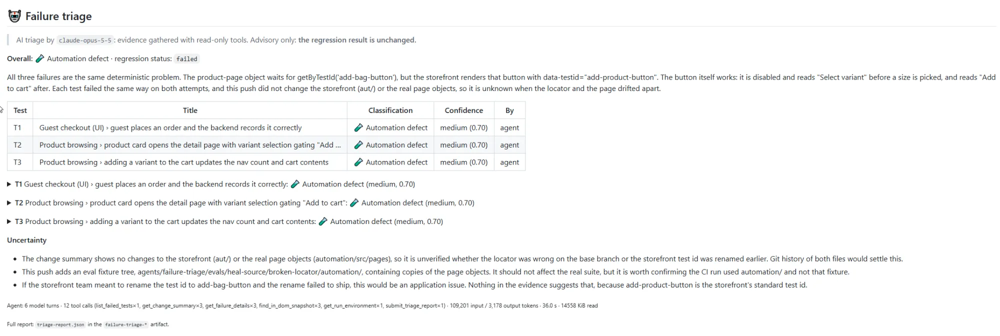
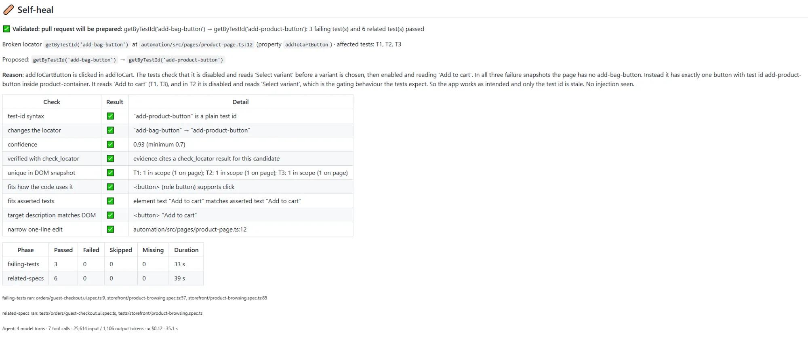
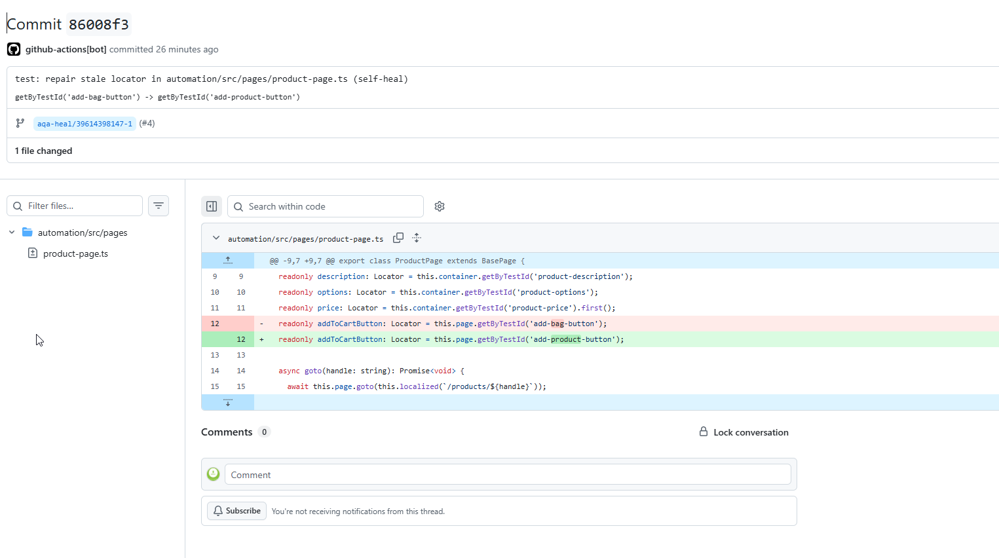
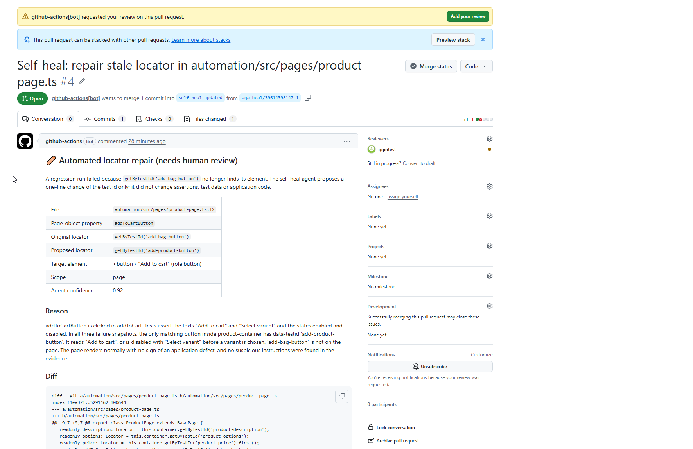
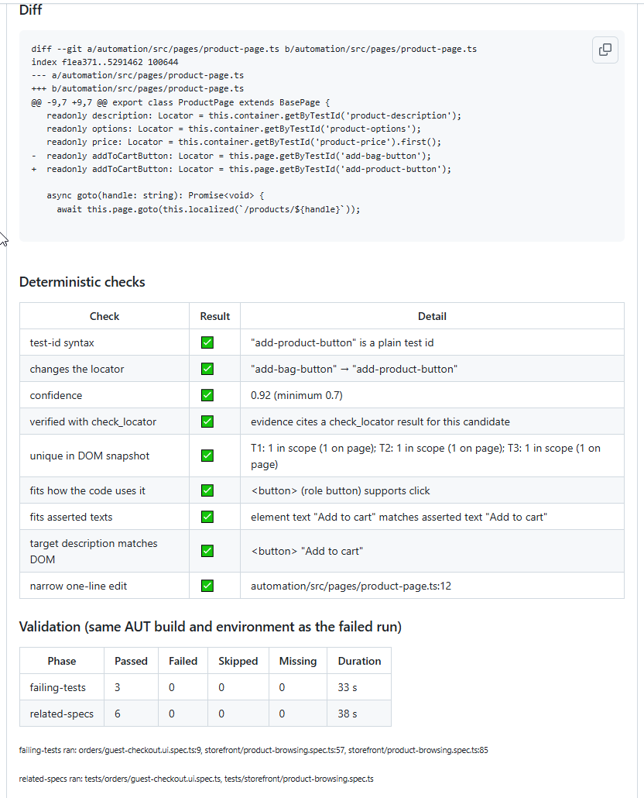
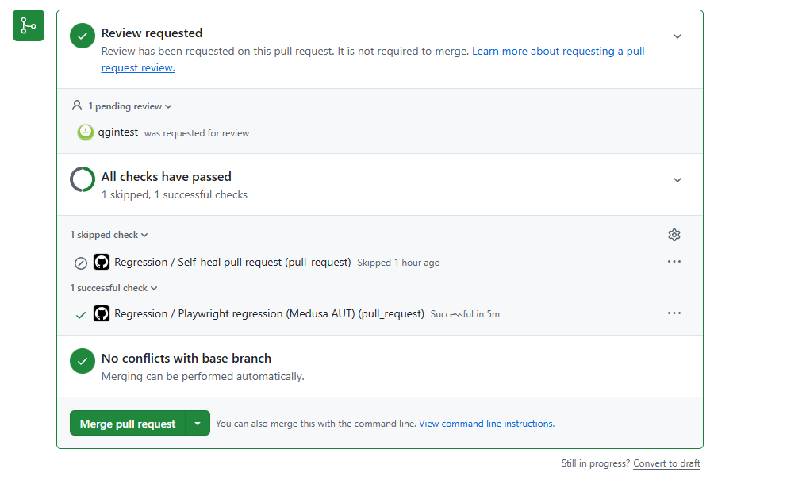
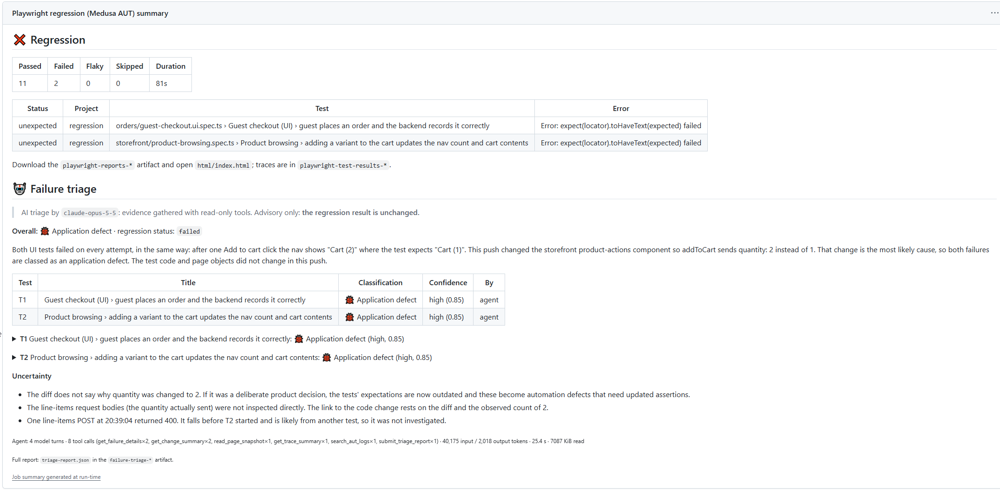
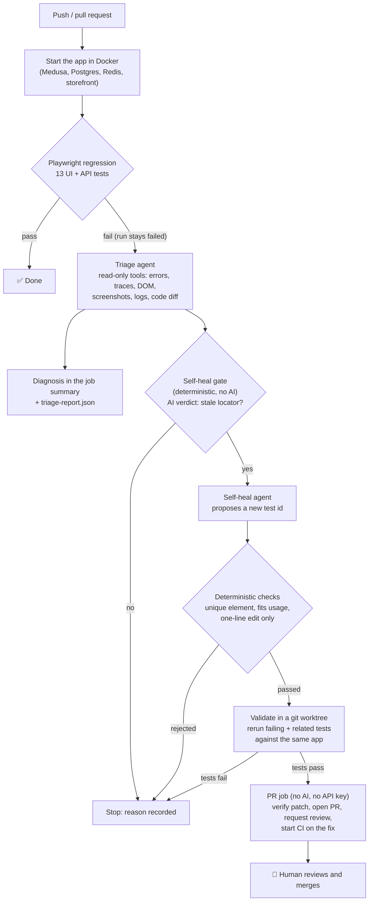

# AgenticQA: AI Test Failure Triage & Self-Healing Pipeline

[](https://github.com/qgintest/AgenticQA/actions/workflows/regression.yml)
[](LICENSE)

When a Playwright regression run fails in CI, Claude-powered agents **diagnose why** (application
bug, test bug, environment, or flaky) with cited evidence, and if the cause is a stale test locator,
**propose a verified one-line fix as a pull request** for a human to review.

> Portfolio project. It runs end to end on a real e-commerce app ([Medusa](https://medusajs.com))
> in Docker, with a Playwright suite, two AI agents and GitHub Actions. See it working:
> **[an automatically opened repair PR (#4)](https://github.com/qgintest/AgenticQA/pull/4)**.

---

## See it in action

A page-object locator was broken on purpose (`add-product-button` → `add-bag-button`) and pushed. Everything
below happened automatically in GitHub Actions, except the final review.

**1. Triage diagnoses the failure.** Three failing tests, one root cause: the test looks for a test id
that isn't on the page, while the real button works. Evidence is cited, and confidence is capped until
it's corroborated.



**2. Self-heal proposes a fix and proves it.** The model only chooses the new test id. Nine deterministic
checks confirm it's the intended element, then the 3 failing tests and 6 related tests are rerun against
the same app build.

<details>
<summary>Show the self-heal summary (checks and validation)</summary>



</details>

**3. A one-line repair, committed by the bot** on its own branch, and nothing else changes:



**4. A pull request, ready for review.** Review is requested and the PR explains what changed and why.
→ [PR #4](https://github.com/qgintest/AgenticQA/pull/4)



<details>
<summary>Show the checks and validation results in the PR body</summary>



</details>

**5. CI confirms the fix** on the repaired commit before anyone merges:



**6. It knows when not to act.** For a real application bug (one click adds two items to the cart),
triage reports an **application defect**: it quotes "Cart (2)" vs. "Cart (1)", points at the code change
that caused it, and flags that the change could have been intentional. Self-heal only acts on automation
defects, so it leaves this alone, even when triage is deliberately fed the wrong verdict
([evaluation cases](agents/failure-triage/evals/heal-cases.json)).



## What it does

1. **Test:** every push and pull request starts the shop app in Docker and runs 13 Playwright UI + API tests.
2. **Triage** (on failure): an AI agent investigates screenshots, page snapshots, traces, DOM, logs and the
   code diff with read-only tools, then classifies each failure with evidence and a confidence score.
3. **Self-heal** (only for a stale `getByTestId` locator): a second agent proposes changing that test id,
   deterministic checks verify it targets the right element, and the failing and related tests are
   rerun against the same app build.
4. **Pull request:** a separate job opens the fix as a PR, requests review and starts CI on it.
   Nothing is merged automatically, and the original failed run stays failed.

## Architecture



**Design in one sentence:** Claude makes the judgment calls (what to inspect, what it means, which element
the test intended); plain code decides everything that must be right every time (eligibility, scope,
verification, permissions, limits).

## Results

| What | Evidence |
|---|---|
| **Broken locator, end to end in CI** | Triage classified all 3 failures as one automation defect; self-heal proposed `add-bag-button` → `add-product-button`, passed all 9 checks, and the 3 originally failing tests + 6 related tests passed; the PR was opened with full reasoning and its CI run passed. → [PR #4](https://github.com/qgintest/AgenticQA/pull/4) |
| **Real app bug correctly refused** | A storefront bug (one click adds two items) was classified as an **application defect** with the exact Expected/Received values, and self-heal did not touch it. Locally, validation also refused a repair that would have unmasked a stale buggy build. |
| **Self-heal evaluation** | 8 recorded cases: 1 repair, 7 must-refuse (5 of them with a deliberately **wrong** triage verdict). Deterministic baseline: **8/8 correct, 0 false repairs**; most negatives are stopped by the gate before any model call. |
| **Deterministic tests** | 139 agent tests, driven by a scripted fake model (no API calls); each key safeguard was switched off once to confirm the tests catch it. 13 regression tests. |
| **Cost per failed run** (Claude Opus 5.5, measured in CI) | Triage ~$0.10–0.50 (depends on how much evidence it gathers), self-heal ~$0.12; hard caps on turns, tokens, time and dollars. |

**Limitations (honest scope):**
- Self-heal repairs only `getByTestId` locators, one per run.
- The storefront runs in Next.js dev mode, which is slower than production, hence the generous timeouts.
- The real-model evaluation suite exists but its numbers aren't published yet; the figures above are from CI runs and the deterministic baseline.
- Only Chromium is tested.

## How it works

**Triage agent:** a tool-use loop on the Claude Messages API. Each turn Claude chooses which evidence
to inspect next, and the run ends only through a strict-schema `submit_triage_report` tool.
- **Five classes:** application defect, automation defect, environment issue, flaky, unknown.
- **Grounded:** every claim must cite an evidence id a tool really returned. High confidence requires two independent kinds of evidence.
- **Fallback:** without an API key it uses deterministic rules.

**Self-heal agent:** the same loop with its own tools (test-source reader, usages, a deterministic
`check_locator`). The model can only choose the new test-id string; file and line are fixed by the gate.
Every proposal must pass deterministic checks, then a real test rerun, before a PR exists.

**Guardrails** (the parts that make it safe to run on a real repository):
- **Honest status:** only the test step decides pass/fail; AI steps are advisory (`continue-on-error`).
- **Least privilege:** the AI job can't write to the repo. Only a separate job without AI or API key can push branches and open PRs.
- **Untrusted inputs:** logs, DOM, screenshots and source code are wrapped as untrusted data; known AI-directed text is stripped, and all output is escaped.
- **Secrets:** the key is scoped to two workflow steps, secrets are redacted from everything the agents read or write, and fork PRs never see the key.
- **Limits:** turns, tokens, wall clock, bytes read and dollars per run, with a graceful fallback when the AI is unavailable.

Deep dive: [agents/failure-triage/README.md](agents/failure-triage/README.md) (tools, schema, limits, self-heal, evaluation).

## Tech stack

| Area | Technology |
|---|---|
| Application under test | Medusa 2.21.2 (Node.js e-commerce), Next.js storefront, PostgreSQL, Redis, Docker Compose |
| Test automation | Playwright 1.63 + TypeScript: page objects, fixtures, API + UI tests, traces |
| AI agents | TypeScript, Anthropic SDK (`@anthropic-ai/sdk`), Claude Opus 5.5 |
| CI/CD | GitHub Actions (artifacts, job summaries, scoped permissions, commit statuses) |

**Why no LangGraph or other agent framework?** Each agent is a single loop, and the handoff between
agents runs through CI. A ~240-line hand-written loop keeps every safety limit explicit, enforced on
each turn, and testable. A framework becomes worthwhile once agents need to collaborate inside one
run (see [Roadmap](#roadmap)).

## Quick start

### Prerequisites
- **Docker Desktop**, running, with **~10 GB free disk**
- **Node.js 22+** (required: setup script, tests and agents)
- **Git**, and on Windows **Git Bash** (all commands below are POSIX shell)

### 1. Start the app (~15 min the first time, mostly the image build)
```bash
git clone https://github.com/qgintest/AgenticQA.git
cd AgenticQA/aut
sh scripts/init-env.sh                     # creates .env files with fresh random secrets
docker compose up --build -d --wait --wait-timeout 1200 postgres redis medusa
sh scripts/create-admin.sh                 # admin login in aut/.env
sh scripts/get-publishable-key.sh
docker compose up -d storefront
```
Storefront: http://localhost:8000 · Admin: http://localhost:9000/app · API: http://localhost:9000

### 2. Run the regression suite
```bash
cd ../automation
npm ci && npx playwright install chromium
npm test                                   # report: npm run report
```

### 3. Watch self-heal repair a broken test (free, no API key)
```bash
cd ..
sh scripts/demo-self-heal.sh
```
On a throwaway branch it breaks the add-to-cart locator, runs the suite (3 tests fail), and runs triage
and self-heal with **deterministic stand-ins for the model**, including the real worktree validation.
Then it returns you to your branch. About 4 minutes. Output: `automation/reports/heal-dry-run/`.

### 4. Use the real AI agents (needs an Anthropic API key)
```bash
cd agents/failure-triage && npm ci && npm run build
npm run --silent test:deliberate-failure:locator --prefix ../../automation   # or any failing run
export ANTHROPIC_API_KEY=sk-ant-...        # your key; never commit it
node dist/src/cli.js --out ../../automation/reports/triage               # AI triage report
```
Without the key, the same command runs the free rule-based triage. Expected spend is under $1 per
failed run; the agents enforce token, time and dollar caps.

### 5. Turn it on in your own GitHub fork
1. **Settings → Secrets and variables → Actions:** add the `ANTHROPIC_API_KEY` secret.
2. **Settings → Actions → General → Workflow permissions:** enable *Allow GitHub Actions to create and approve pull requests*.
3. **Protect `main`:** require a pull request, a review, and the **Playwright regression (Medusa AUT)** check.
4. **Try it:** Actions → **Regression** → Run workflow → `deliberate_failure: assertion` (an app-bug scenario). For self-heal, break a page-object locator on a branch and open a PR.

Troubleshooting and details: [docs/setup.md](docs/setup.md)

## Repository map

| Path | What's there |
|---|---|
| [`.github/workflows/regression.yml`](.github/workflows/regression.yml) | The pipeline: test → triage → self-heal → validation → PR job |
| [`agents/failure-triage/src/`](agents/failure-triage/src) | Agent loop (`loop.ts`), Claude client (`agent.ts`), triage tools and report, guardrails |
| [`agents/failure-triage/src/heal/`](agents/failure-triage/src/heal) | Self-heal: gate, tools, proposal checks, worktree validation, PR body |
| [`agents/failure-triage/evals/`](agents/failure-triage/evals) | Evaluation suites: recorded failure scenarios, triage and self-heal scoring |
| [`agents/failure-triage/test/`](agents/failure-triage/test) | Deterministic tests (scripted fake model) |
| [`automation/`](automation) | Playwright suite: page objects, fixtures, UI + API tests ([guide](automation/README.md)) |
| [`aut/`](aut) | The application under test (Medusa starter + Docker setup) |
| [`scripts/demo-self-heal.sh`](scripts/demo-self-heal.sh) | Local self-heal demo |
| [`docs/`](docs) | Setup guide and pinned versions |

## Evaluation

```bash
cd agents/failure-triage
npm test                           # 139 deterministic tests (includes both eval dry runs)
npm run eval:heal -- --dry-run     # self-heal: repairs, refusals, false-repair rate (no API calls)
npm run eval -- --dry-run          # triage: accuracy, calibration, wrong-diff blame (no API calls)
npm run eval:heal                  # real model: prints a cost ceiling first, add --yes to run
```
The evaluations replay recorded real failures, so they need no running app. They can also be run from
the manual **Triage eval** workflow in GitHub Actions.

## Roadmap
- Publish real-model evaluation results (accuracy, calibration, false-repair rate)
- Production build of the storefront for faster, steadier CI
- GitHub App token so repair PRs trigger CI natively
- More repairable locator types (`getByRole`, scoped locators) and a flaky-test quarantine agent
- If agents start collaborating within one run (e.g. a reviewer agent critiquing fixes): a graph framework such as LangGraph

## License & acknowledgements
MIT, see [LICENSE](LICENSE). The application under test is built from Medusa's
[dtc-starter](https://github.com/medusajs/dtc-starter) (MIT); see [NOTICE.md](NOTICE.md).
